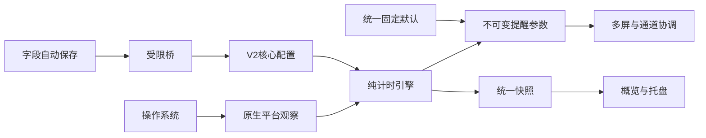
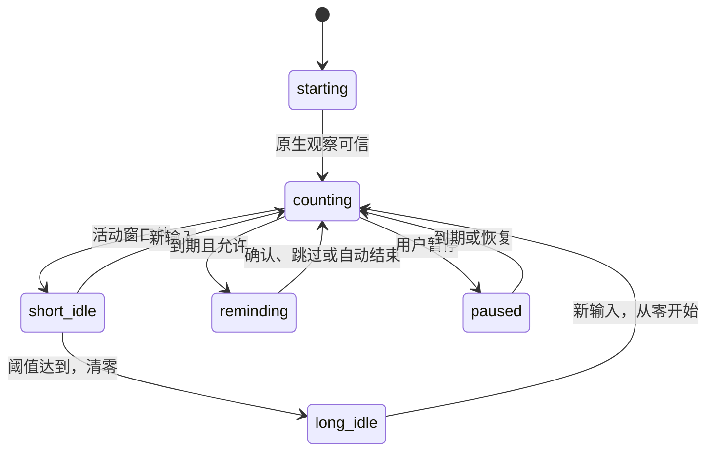

# EyeCare 技术与交互设计

状态：2026-10-13用户授权实施的V2精简方案。行为以prd.md和research/simplified-settings.md为准；本机证据见execution.md及docs/acceptance.md。旧高级配置/延期设计已替代，跨平台原生验收范围保留。

## 架构与数据流

Electron44/TypeScript/React/Vite/Forge沿用现有工程。主进程独占计时、平台观察、持久化和提醒协调；renderer只持有字段输入与展示状态。平台输入不采集内容。

SettingsV2只包含8项和schemaVersion2；PRODUCT_DEFAULTS集中定义固定高级值。resolveSettings把核心值与默认约定组合为ResolvedSettings，供每次ReminderEvent创建时复制。RuntimeSnapshot.settings与save/preview桥只使用V2，不能通过IPC改固定参数。reduceMotion/reduceTransparency由平台系统偏好解析，snapshot仍携带有效展示状态。

## 时间状态机

状态：starting/counting/short_idle/long_idle/locked/sleeping/paused/reminding/capability_error。不存在延期状态或截止点。所有计时模式与通道共用抑制条件。

优先级与采样沿用既有安全契约：锁屏/睡眠/关键故障/手动暂停/长空闲阻断新效果，缺失>5秒的采样不记为活动。使用原生连续时钟，不能用渲染器定时器或系统墙钟驱动计时。

累计输入固定combined，活动窗口60秒；取采样区间与最后输入有效窗口的交集。固定周期只保留未来节拍，不追赶抑制期间的旧事件。长空闲阈值为核心配置，即使手动暂停也清零；短缺席在无提醒被取消时保留累计，取消已创建提醒消耗本轮。重启不保存运行进度。

## 提醒生命周期

创建时固定ID/generation/kind/ResolvedSettings/屏幕ID集合/创建时刻。首次有效终结关闭所有关联窗口，旧/重复消息无副作用；跨窗口的视图不能各自重置计时。

| 结束 | 休息确认 | 下一轮 |
|---|---|---|
| 蒙版知道了 | 一次 | 点击时清零并重建周期 |
| 蒙版关闭/Escape | 否 | 跳过时重建周期 |
| 闪屏自动结束 | 否 | 自动进入下一轮 |
| 通知提交/声音结束 | 否 | 自动进入下一轮 |
| 抑制取消/全部通道失败 | 否 | 消耗本轮，无恢复补发 |

只支持acknowledge/skip；旧snooze请求拒绝，接口、快照、预览结果与引擎都移除延期字段/分支。选仅声音时renderer原子设置visual=none、soundEnabled=true，服务端仍校验至少一个通道。仅声音不允许关闭声音。

闪屏2秒、20%、颜色随主题；声音gentle/50%；文案内置；所有显示器。系统减少动态改静态短提示。全部遮罩共享同一事件，热插拔重新计算实际全部屏幕，窗口失败/renderer崩溃/退出统一清理。视觉正常收尾停止剩余附加音效；通知与独立声音组合时通知静音。预览ID独立，确认/自动结束都不重置实际计时或计为休息。

## 配置持久化与迁移

保存包仍是settings+revision；严格拒绝未知字段、无效时间与无通道组合，保存成功落盘后才更新有效状态。原子临时写入、最后有效备份和串行revision检查沿用。

仅在存储读取路径接受严格有效V1，用旧验证规则确认完整来源后映射8项为V2。固定高级参数不迁入V2。首次原子升级前保留settings.v1-backup.json原字节，不覆盖旧迁移备份。主文件和last-good都可读取旧版迁移；迁移失败不损坏原文件，警告并使用可用的内存V2，后续保存/重启可重试。迁移本身不注册/删除OS登录项。

登录启动仍用既有稳定launcher和平台API，保存变更需先捕获真实OS状态再apply/read-back；失败保留旧有效设置并恢复捕获值，不能用磁盘旧偏好代替OS快照。捕获失败不修改任何状态；回滚失败单独报告。Windows仅保存本应用确切Run/StartupApproved值的类型/原值/批准字节；Linux保存desktop原字节/权限/缺失状态并原子恢复。保留Windows系统禁用状态及确属本应用的旧路径迁移逻辑。所有运行计时/提醒ID不持久化。

## 页面与自动保存

三页仅包含3+2+3项核心配置。没有高级页面、手动save/discard、未保存离页对话框或声音预听按钮。Restore一次确认后通过同一保存队列提交默认核心设置。

SettingsEditor字段版本与最新有效baseline独立，离散编辑即时保存，数值300毫秒合并/blur flush；只清除被该成功响应确认的同版本intent。旧snapshot/response不能覆盖新输入或主题。合法无关字段可独立提交；无效输入保留，服务器冲突/落盘/登录失败明确反馈并允许重试。登录开关在失败时展示旧有效值，同时保留重试意图。

主窗口880x620，最小640x520；现有LiquidGlass语义tokens、CJK系统字体、键盘焦点、亮暗对比度及系统减动/透明度回退保留。概览规则摘要简化；系统能力正常时不展开，只有异常时显示必要原因。

托盘点击仅呈现原生菜单，不创建额外倒计时窗口。Mac沿用setContextMenu的原生点击行为，其他平台左键打开同一菜单；所有操作仍调用主进程既有回调。

## 跨平台与质量边界

Mac原生连续时钟/合并输入/显式当前会话锁和模板Tray沿用已验证修复。Windows WTS+inputdesktop、稳定Squirrel启动路径、Linux X11/XScreenSaver+会话/桌面双锁检查沿用。未知关键观察停发提醒；Wayland能力不可靠时明确受限。

纯测试证明时间、配置和清理逻辑；真实Electron测试证明桥/窗口/页面；Mac打包版需单独检查V1迁移、V2保存与确认流程。物理锁屏/睡眠、多显示器/Spaces、签名通知、更多主机与长期性能仍由docs/acceptance.md追踪，构建不等于完整原生验收。
