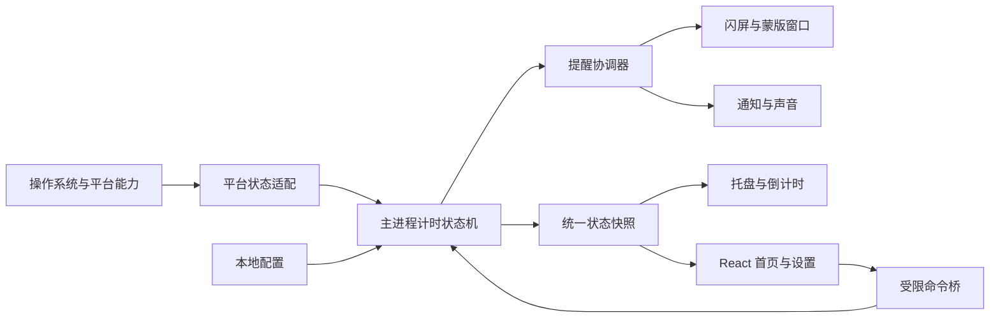
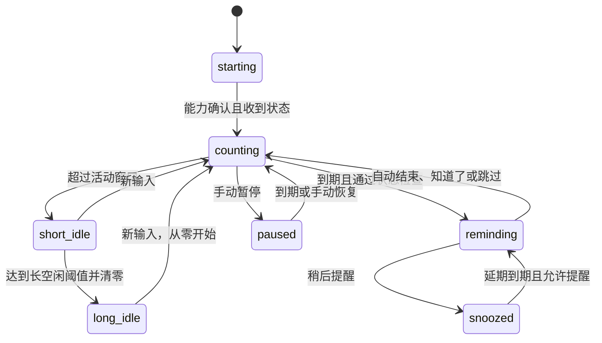

# EyeCare 技术与交互设计

> 当前状态（2026-10-10）：用户已授权按本文实现，并确认先交付本机可验证版本。Windows 实现、构建与安装测试证据见 execution.md 和 docs/acceptance.md。下文设计阶段的停止要求为历史记录，已由本次授权取代；原需求及跨平台验收范围保持有效。

状态：设计文件，无产品代码。默认配置与功能范围以 prd.md 为准；用户要求在实现前停止。

## 技术选择

采用 Electron + TypeScript + React + Vite，使用 Electron Forge 打包。选择理由：桌面窗口、托盘、系统主题、通知与电源状态接口集中，React 便于统一两套主题与复杂设置；不足是包体和常驻内存较大、Linux 仍需原生适配。Tauri 体积更小但当前项目无 Rust 基础，相关平台桥接会增加第一版实现成本，暂不选用。

核心计时纯 TypeScript，独立于 React 和 Electron；主进程是唯一运行状态所有者。界面关闭不停止计时，不依赖渲染线程定时器。平台适配允许使用小型本地原生桥接，具体依赖在实现首阶段锁定，当前不安装或生成脚手架。

## 模块与数据流

| 模块 | 职责 | 禁止职责 |
|---|---|---|
| TimerEngine | 活跃累计、固定截止点、暂停、清零、唯一提醒事件 | 读取 UI 状态、创建窗口 |
| PlatformAdapter | 输入空闲、锁屏/睡眠、屏幕、系统主题、能力报告 | 记录输入内容、伪造未知状态 |
| ReminderCoordinator | 多通道投递、取消、多屏幂等收尾 | 单独维护另一套计时 |
| TrayPresenter | 根据同一快照更新标题/图标/提示/面板 | 显示开关控制真实计时 |
| SettingsStore | 校验、版本化配置、原子保存 | 持久化活动输入或历史屏幕 |
| PreloadBridge | 暴露固定白名单命令与快照订阅 | 暴露整个 Electron/Node API |
| Renderer | 页面、主题 tokens、表单、预览 | 决定何时正式提醒 |

拟议代码目录：app/main/{engine,platform,reminders,tray,settings}、app/preload、app/renderer/{pages,components,theme}、app/shared/contracts、tests。这里只记录目录方案，不创建源文件。

## 状态模型

主状态：starting、counting、short_idle、long_idle、locked、sleeping、paused、snoozed、reminding、capability_error。锁屏/睡眠/暂停等保存为独立状态位，界面按优先级映射到一个可读状态，避免恢复时丢失用户暂停状态。

优先级：锁屏/睡眠 > 关键能力故障 > 手动暂停 > 长空闲 > 提醒显示 > 延期 > 短空闲 > 正常计时。长空闲检查即使在暂停/延期中也执行，累计清零不能被更高优先级遮蔽。

关键量：累计有效毫秒、固定周期锚点及截止点、当前提醒 ID、配置版本、延期截止点、暂停截止点、锁屏/睡眠起点、最后处理的采样序号。运行量不落盘；重启新周期。

图仅展示主路径。锁屏/睡眠/故障可以从任一状态打断；恢复后重算优先级，不复活旧提醒。

## 时间与活动契约

1. 默认每秒采样一次，所有时间字段使用毫秒。调度依据单调时间差或可信的包含睡眠时长的连续时钟；修改系统时间不能让累计进度跳变。
2. 累计的是采样区间与“最后输入 + 活动窗口”内有效时段的交集，不能简单每次回调加一秒；回调延迟不重复计时，边界采样正常误差不超过 2 秒。
3. 合并输入决定长空闲；选定活动来源决定活动累计。仅鼠标时，键盘输入不增加鼠标累计，但能阻止长空闲清零。
4. 锁屏、睡眠、手动暂停、延期、提醒显示、关键能力故障期间不累计。长空闲超过阈值只清零一次，等待新输入。
5. 采样缺失超过 5 秒时，不把未知区间计为活跃；重新采样并报告延迟。睡眠恢复先读取真实系统状态，不累加整段睡眠差值。
6. 睡眠/锁屏的持续时间采用平台可信时钟；无法确认持续时长时保守清零并提示状态异常，不把未知长区间视为活跃。
7. 固定周期用锚点与未来截止点计算，不创建历史事件队列。恢复时推进到严格晚于当前的下一节拍。
8. 到期提交事件前再次检查锁屏/睡眠和能力；状态变化与事件按序列处理。任何窗口真正显示前也检查事件版本与取消标记。

例：累计已用 25 分钟，超过活动窗口后暂停；长空闲达到 10 分钟清零，恢复后重新累计 30 分钟。空闲阈值不能硬编码为 10 分钟。

## 提醒生命周期

事件拥有 reminderId、generation、kind、配置快照、选定屏幕、创建时间、通道结果。生命周期为 created → presenting → resolved/cancelled。结束消息必须匹配 ID 和 generation；第一次有效消息终结事件，后续同一事件消息无副作用。

| 结束原因 | 休息完成 | 周期行为 |
|---|---|---|
| 闪屏自动结束 | 否 | 从结束时开始下一轮 |
| 蒙版“知道了” | 是，用户确认 | 清零，从点击时开始下一轮 |
| 蒙版 Escape | 否 | 从跳过时开始下一轮 |
| 通知提交成功 | 否 | 提交后进入下一轮，点击旧通知只开首页 |
| 仅声音播放结束 | 否 | 播放结束后进入下一轮 |
| 延期 | 否 | 保留当前累计，独立截止点接管 |
| 全部通道失败 | 否 | 结束本轮并开始下一轮，显示故障，不自动升级方式 |
| 锁屏/长空闲/手动暂停取消已创建事件或延期 | 否 | 消耗当前轮次，取消时清零累计；恢复后开始新周期，不复活到期事件 |

仅仅进入锁屏/手动暂停且没有提醒事件或延期时，短时累计进度仍按需求保留。区别在于已经创建过的提醒周期不能在恢复后再次补弹。

视觉+声音同时存在时，视觉生命周期决定正常收尾，声音是一次附加动作；视觉先结束则停止剩余声音。声音失败不关闭成功显示的视觉提醒。通知成功且声音失败仍视为本轮已投递；所有结果保留可理解的状态摘要，不持久化休息统计。

多屏窗口共用事件 ID；任一屏“知道了”关闭全部窗口。热插拔后重新计算目标显示器，不增加新事件；指定屏幕移除时临时回退主屏并提示，不改变用户保存的选择。异常退出、renderer 崩溃或窗口失联时销毁残余遮罩，不能留下阻挡输入的窗口。

## 窗口与托盘

闪屏采用每个目标显示器一个无边框、透明、不可聚焦且点击穿透的遮罩；不进入 kiosk 模式。蒙版使用相同屏幕集合但允许交互，内容区支持键盘与 Escape。每次创建/显示先核对当前允许状态；主窗口与蒙版分开管理。

macOS 托盘旁标题使用等宽数字 MM:SS，大于一小时用 H:MM:SS。Windows/Linux 图标显示向上取整的剩余分钟数，低于一分钟显示“<1”，超过 99 分钟显示“99+”；悬浮说明和面板带完整时间和单位，避免切换单位导致数值从 1 跳到 59。面板统一秒级倒计时。图标尺寸和 DPI 按平台生成，关闭显示恢复标准图标。不每秒无必要地重建原生菜单。

首页剩余时间与托盘都来自 RuntimeSnapshot；渲染界面只能平滑显示，不能独立推进核心状态。短空闲显示冻结时间，长空闲显示等待活动，暂停/锁屏/故障显示原因，延期显示延期剩余时间。

## 跨平台适配与验收基线

| 能力 | macOS | Windows | Linux X11 | Wayland |
|---|---|---|---|---|
| 合并输入空闲 | powerMonitor，必要时 native 校正 | powerMonitor / GetLastInputInfo | powerMonitor 或 XScreenSaver 适配 | 桌面服务/协议专项验证 |
| 仅鼠标 | 本地事件时间桥接，评估所需权限 | 原生鼠标来源桥接 | XInput2 来源桥接 | 不可靠时明确禁用 |
| 锁屏/睡眠 | 原生事件+启动时查询 | 原生事件+启动时查询 | logind 会话属性+桌面锁屏服务 | 按实际桌面双重确认 |
| 屏幕遮罩 | Electron 窗口与空间适配 | 窗口覆盖目标显示器 | 窗口管理器适配 | 普通 Electron 窗口不保证置顶/定位；需专用适配 |
| 托盘 | 标题+图标 | 动态图标+tooltip | StatusNotifier/桌面能力 | 按桌面托盘支持 |

Linux 的 logind LockedHint 是会话提示，不把 Lock 信号本身当作锁屏已完成；需要启动时读取和后续属性变化，并与桌面实际状态验证。IdleHint 是提示而非秒级输入计时来源。Wayland 不能以强制 Xwayland 参数代替全桌面输入检测或保证所有 Wayland 窗口上方覆盖。

完整支持的发布条件是关键能力实机通过；未通过环境只能明确展示受限能力，不能默认为 active/unlocked。Linux 全屏接口失败时允许用户选择通知/声音，但不得静默替换默认闪屏并声称全功能支持。

官方证据见 research/platform-capabilities.md。当前所有原生桥接都是设计路径，未实现或验证。

## 配置与接口设计

设置存储于 app.getPath('userData') 下的版本化 settings.json，原子临时文件替换，保留最后有效备份。首次使用默认表；损坏配置回退默认并提示；保存失败保持旧有效值。运行累计、提醒 ID 和暂停不恢复，避免过期提醒。

具体字段、IPC、错误矩阵与断言点见 .trellis/spec/backend/runtime-contract.md；UI 与主题约束见 .trellis/spec/frontend/ui-contract.md。这些是计划契约，不是现有接口。

没有正在呈现的正式提醒时，保存计时参数重置周期；正在呈现时保存到下一周期，不替换当前提醒参数快照。主题/托盘显示切换始终即时生效且不重置，其他外观参数不重置。保存时校验配置 revision 防止多个窗口覆盖；冲突返回最新快照供重试。活动来源不支持、无可用屏幕、视觉 none 且声音关闭等无效配置均拒绝。

preload 只暴露白名单命令；renderer 不启用 Node、不加载远程页面；验证调用来源及 payload，不允许命令传入任意文件路径、shell 或 IPC channel。外链通过明确的受控操作处理。

## 页面与交互布局

主窗口 880×620，最小约 640×520，侧栏约 168；窄窗导航收起为带文字的紧凑栏。低于最小尺寸由系统限制，不裁切必要操作。

| 页面 | 首屏重点 | 次级内容 |
|---|---|---|
| 概览 | 状态、56–64px 主倒计时、暂停/立即提醒 | 人可读规则摘要、能力异常入口 |
| 触发条件 | 两模式选项+对应时长 | 活动窗口/来源高级组、长空闲阈值、保存 |
| 提醒方式 | 三种视觉方式卡片、独立声音开关 | 屏幕范围、方式参数、预览、保存 |
| 通用设置 | 系统/亮/暗主题、倒计时开关 | 开机启动、动态/透明度回退、诊断、恢复默认 |
| 托盘面板 | 状态、完整倒计时、暂停/恢复 | 立即提醒、设置、退出 |
| 确认蒙版 | 居中提醒文字、知道了 | 稍后提醒和 Escape 提示 |

正文与输入框使用稳定表面，玻璃主要在导航、控件和托盘面板。系统字体、等宽计时数字、一致线性图标；文字不做每秒翻滚。主题遵循 MASTER.md，不把模糊当作必需能力。主题与倒计时开关立即保存，其余表单保存按钮一次提交；未保存离开页面提示保留或放弃。

## 性能、验证与回退

核心每秒一次采样，系统事件即时处理；不监听或持久化高频键盘内容，不持续计算光学折射。遮罩窗口仅提醒期间存在，后台只保留托盘与轻量采样。实现后记录目标平台 CPU/内存基线，再决定是否需要 native helper 独立进程，当前不声称性能数字。

状态机用可注入时钟与平台事件进行确定性测试；实际锁屏、睡眠、DPI、多屏、虚拟桌面、通知签名和权限需要实机。支持清单以结果生成，不以“跨平台框架”推断。

玻璃失效回退不透明同语义表面；输入能力失败禁用活动模式；锁屏能力失败停发全部新提醒；失败不能变成无限重试、死锁或不可关闭蒙版。

## 停止点

设计、研究、契约与实施计划准备完成后停止。没有代码脚手架、依赖安装、应用构建或产品测试；任务保持 planning。未来进入实现需新的用户授权，并先通过 implement.md 中的平台验证门槛。
