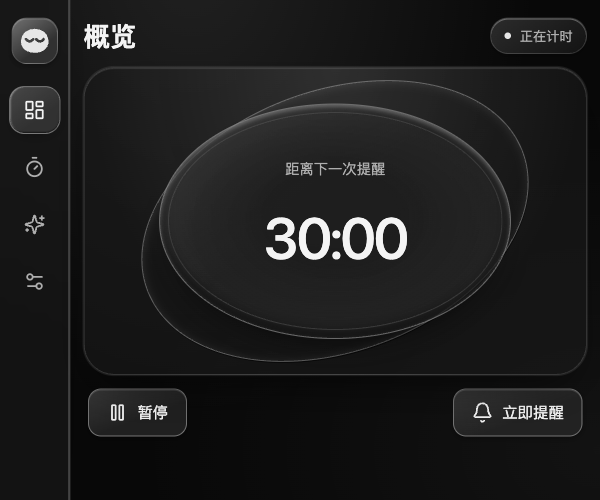
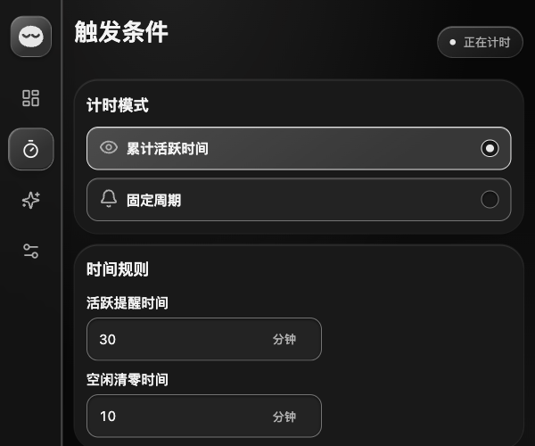
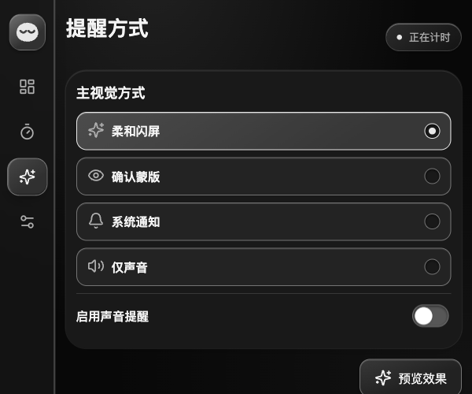
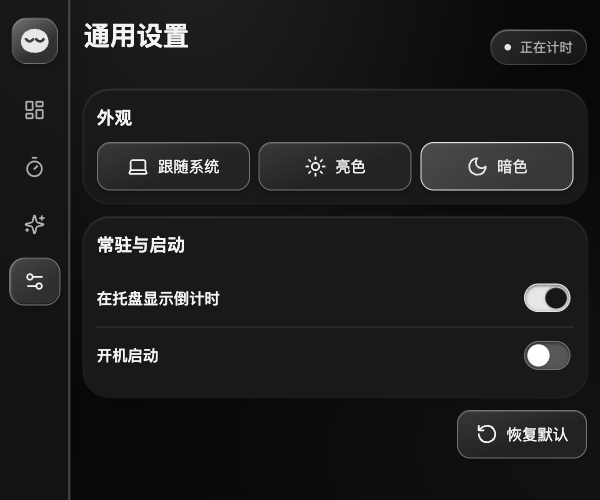
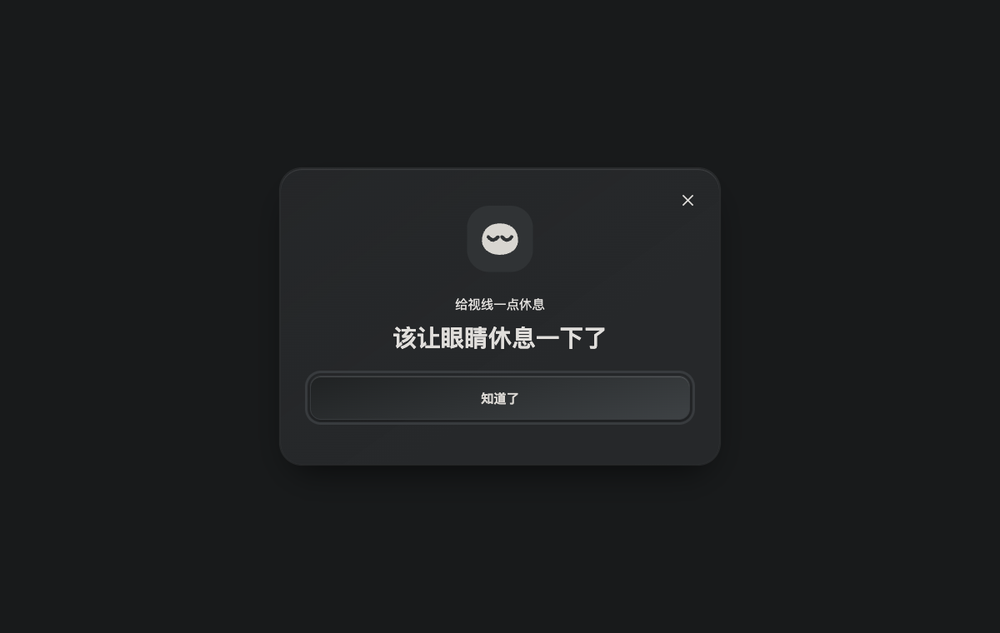
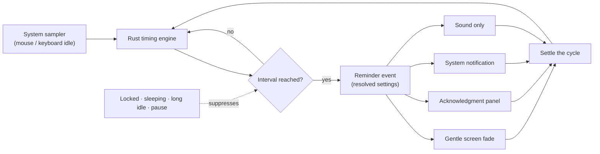

<div align="center">
  

  # EyeCare

  **Give your eyes a break.**

  A tray-resident break reminder for macOS, Windows and Linux. It follows real mouse and keyboard activity, nudges you to rest, and keeps every setting on your own machine.

  <a href="LICENSE"></a>
  
  
  
  
  

  **English** · <a href="README.zh-CN.md">简体中文</a>
</div>



## Highlights

- **Counts work, not wall-clock time.** Idle stretches do not consume your interval, so the reminder arrives when you have actually been staring at the screen.
- **Four reminder channels.** A gentle full-screen fade, an acknowledgment panel, a system notification, or sound only — combine a visual with sound if you like.
- **Quiet by default.** Locking, sleeping, extended idle time or an unknown critical capability suppresses new reminders. Missed reminders are never replayed.
- **Rust owns the clock.** The interval, the sampler and reminder state live in the Rust core; the UI renders snapshots and sends commands.
- **Everything stays local.** No keystroke content, no pointer trails, no screen captures, no network calls.

## Features

| Area | What you get |
| --- | --- |
| Timing modes | Accumulated active time or a fixed interval |
| Reminder types | Gentle screen fade, acknowledgment panel, system notification, sound only |
| Away detection | A 60-second activity window; long idle resets progress without firing a reminder |
| Tray | Live countdown in the menu bar, pause / resume, remind now, settings, quit |
| Manual pause | Stays paused until you resume, across as long as you leave it |
| Settings | Eight core options, saved automatically, validated before they hit disk |
| Appearance | Light, dark or system; Liquid Glass surfaces; respects reduced motion and reduced transparency |

## Screenshots

The interface ships in Simplified Chinese.

| Overview (概览) | Trigger conditions (触发条件) |
| --- | --- |
|  |  |
| **Reminder type (提醒方式)** | **General settings (通用设置)** |
|  |  |

The acknowledgment panel is the only reminder that replies to you — "Got it" (知道了) records a confirmed break and starts the next cycle:



## How a cycle works



The rectangle in the middle is what you configure; everything else is fixed. Effect timing, wording, sound and display coverage are conventions rather than settings, and there is no snooze.

### Timing and reminder rules

| Scenario | Behaviour |
| --- | --- |
| Accumulated active time | Any mouse or keyboard input maintains a fixed 60-second activity window; accumulation stops outside it |
| Fixed interval | Reminds on the configured interval; cycles suppressed by locking, sleep or manual pause are skipped |
| Idle reset threshold reached | Progress resets and no reminder fires; progress also resets while paused |
| Gentle screen fade | A full-screen black layer fades in, holds and fades out over about 2 seconds, peaking at 90% opacity; it never takes focus and clicks pass through |
| Acknowledgment panel: Got it (知道了) | Closes the panel, records a confirmed break, resets progress and starts the next cycle |
| Close panel / Escape | Skips this cycle without recording a confirmed break |
| Notification posted / sound finished | Ends the cycle automatically without recording a confirmed break |
| Preview (预览效果) | Never touches real timing progress or confirmed breaks |

Reminders cover every connected display. The built-in sound plays once per cycle at a fixed 50% volume.

## Settings reference

| Page | Setting | Default | Range / options |
| --- | --- | --- | --- |
| Trigger conditions | Timing mode (计时模式) | Accumulated active time (累计活跃时间) | Accumulated active time / Fixed interval (固定周期) |
| Trigger conditions | Active reminder time (活跃提醒时间) | 30 minutes | Whole minutes, 1–240 |
| Trigger conditions | Idle reset threshold (空闲清零时间) | 10 minutes | Whole minutes, 1–120; shown in accumulated active time mode |
| Reminder type | Primary visual (主视觉方式) | Gentle screen fade (柔和闪屏) | Gentle screen fade / Acknowledgment panel (确认蒙版) / System notification (系统通知) / Sound only (仅声音) |
| Reminder type | Enable reminder sound (启用声音提醒) | Off | On / Off; forced on when Sound only is selected |
| General settings | Theme (外观) | Follow system (跟随系统) | Follow system / Light (亮色) / Dark (暗色) |
| General settings | Tray countdown (在托盘显示倒计时) | On | On / Off |
| General settings | Launch at login (开机启动) | Off | On / Off |

Saving is automatic: numeric fields commit roughly 300 milliseconds after you stop typing, or when the field loses focus. Invalid values or a failed write keep the last valid configuration and explain what happened. Restoring defaults asks for confirmation first.

Option labels shift with the mode — the interval reads Active reminder time (活跃提醒时间) under accumulated active time, and Interval (间隔时间) under a fixed interval. At narrow widths the sidebar collapses to icons and each icon reveals its page name on hover.

## Quick start

### Requirements

- **Node.js 24** (the release workflow pins 24.15.0) and **npm 11**
- **Rust 1.90+**, installed through [mise](https://mise.jdx.dev/) so the `npm` scripts resolve the same toolchain (`mise install`)
- Tauri platform prerequisites: Xcode command-line tools on macOS, MSVC C++ build tools plus WebView2 on Windows, or WebKitGTK 4.1 and the usual build libraries on Linux
- Git, and a running desktop session

### Run from source

```bash
git clone https://github.com/ShenZiLi/EyeCare.git
cd EyeCare
npm ci
npm start
```

`npm start` launches the Tauri window together with the Vite dev server. `npm run vite:dev` alone serves the frontend, but native commands need the Tauri host.

## Build and package

```bash
npm run package   # Compile the app without generating installers
npm run make      # Compile and produce native bundles
```

Bundles land in `src-tauri/target/release/bundle/` — DMG and `.app` on macOS, MSI and NSIS on Windows, deb, rpm and AppImage on Linux. Build on the target operating system; signing follows Tauri's platform signing configuration.

## Development and verification

Stack: **Tauri 2 · Rust · React 19 · TypeScript · Vite**.

```bash
npm run check             # TypeScript, lint, frontend tests and Rust tests
npm run test:unit         # Frontend settings and controller tests
npm run test:integration  # Rust runtime tests (cargo test)
npm run vite:build        # Frontend production build
npm run tauri:build       # Native production build and bundles
```

```text
EyeCare/
├── app/renderer/   # React pages, overlays and the Tauri invoke/listen bridge
├── app/shared/     # TypeScript contracts and settings validation
├── src-tauri/      # Rust runtime: engine, platform adapters, settings, tray, reminders
├── tests/unit/     # Frontend controller and settings tests
├── resources/      # Source artwork and generated assets
├── scripts/        # Asset generation
└── docs/           # Migration notes, acceptance evidence and README imagery
```

The Rust runtime owns timing and reminder state. Pages render snapshots and send commands; closing the main window hides it and leaves the tray runtime running.

## Platform support

macOS, Windows and Linux are all build targets. macOS ships a native adapter for input, clock and lock state; Windows and Linux currently report reduced capabilities and suppress reminders whenever a critical state is unknown.

Full parity on Windows and Linux — physical lock and sleep detection, multi-display coverage, notification delivery and launch at login — still needs on-device acceptance. Files under `docs/` record earlier implementation evidence and the Tauri migration checklist; historical results from the retired Electron implementation do not establish behaviour here.

## Privacy

- EyeCare reads system activity and idle state only. It never records keystroke content, pointer trajectories or screen images, and it makes no network requests.
- Settings live in `settings.json` inside Tauri's application data directory for `org.eyecare.desktop`. On first run the app imports an existing configuration from the legacy EyeCare directory.
- The last valid configuration is kept as `settings.last-good.json`; a legacy file is preserved as `settings.v1-backup.json` before it is upgraded.
- Upgrading from an older version keeps your eight core choices; retired advanced parameters no longer affect runtime behaviour.
- Restarting restores your settings and starts a fresh cycle. Reminders missed while the app was closed are not replayed.

## FAQ

**macOS notifications never appear.**
Test with the bundled app, then check System Settings → Notifications → EyeCare. Permission state, Focus modes and screen sharing can all swallow banners. A successful submission is not proof of a visible banner.

**The countdown stopped moving, or reminders stopped arriving.**
Under accumulated active time, accumulation pauses once the 60-second activity window expires. Manual pause, locking, sleep, long idle time or an unconfirmed critical capability also suppress reminders. Resume from the tray or the Overview page after a manual pause.

**Launch at login did not take effect.**
Read the error the app reports, then check your system's login item settings. When registration or the write fails, EyeCare keeps the last valid configuration and tries to restore the previous system state. You can retry in the app.

**The build succeeded — where is the app?**
Look in `src-tauri/target/release/bundle/` after `npm run make`. `npm run package` compiles on purpose without producing installers.

**Can I change the fade duration, wording or sound?**
No. Those follow fixed conventions so the reminder stays predictable. The eight options above are the whole configuration surface.

## Contributing

Report bugs and propose improvements through [Issues](https://github.com/ShenZiLi/EyeCare/issues); send code through [Pull Requests](https://github.com/ShenZiLi/EyeCare/pulls).

A useful issue includes your OS version, CPU architecture, desktop environment or X11/Wayland session, EyeCare version, reproduction steps, expected behaviour, and screenshots of any error. Never attach credentials or configuration files containing private data.

Run the relevant checks before opening a pull request and add focused tests for behaviour changes. For anything touching system capabilities, describe the real-device environment you tested on and note what remains unverified.

## License

[MIT](LICENSE) © 2026 EyeCare contributors
