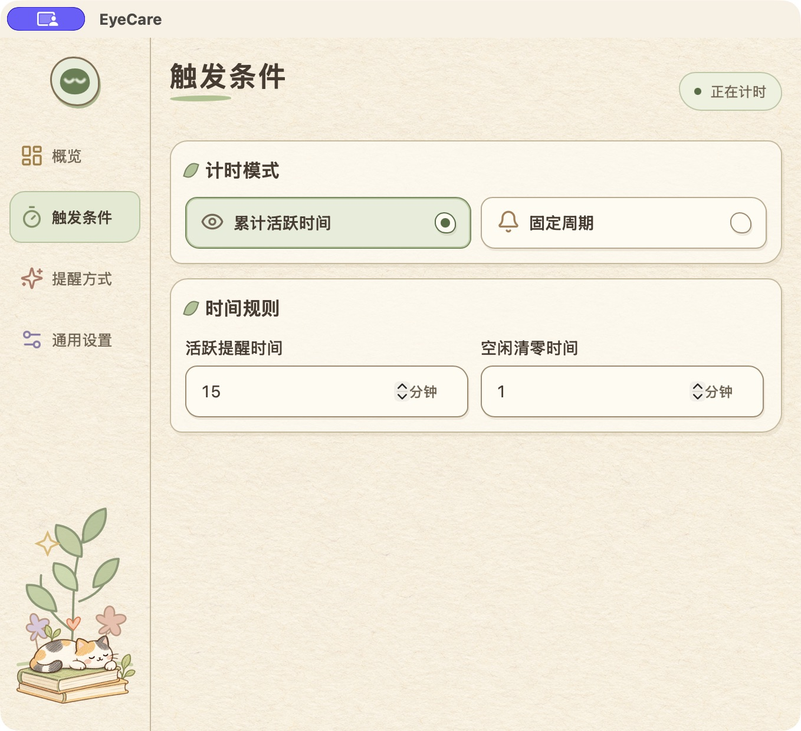
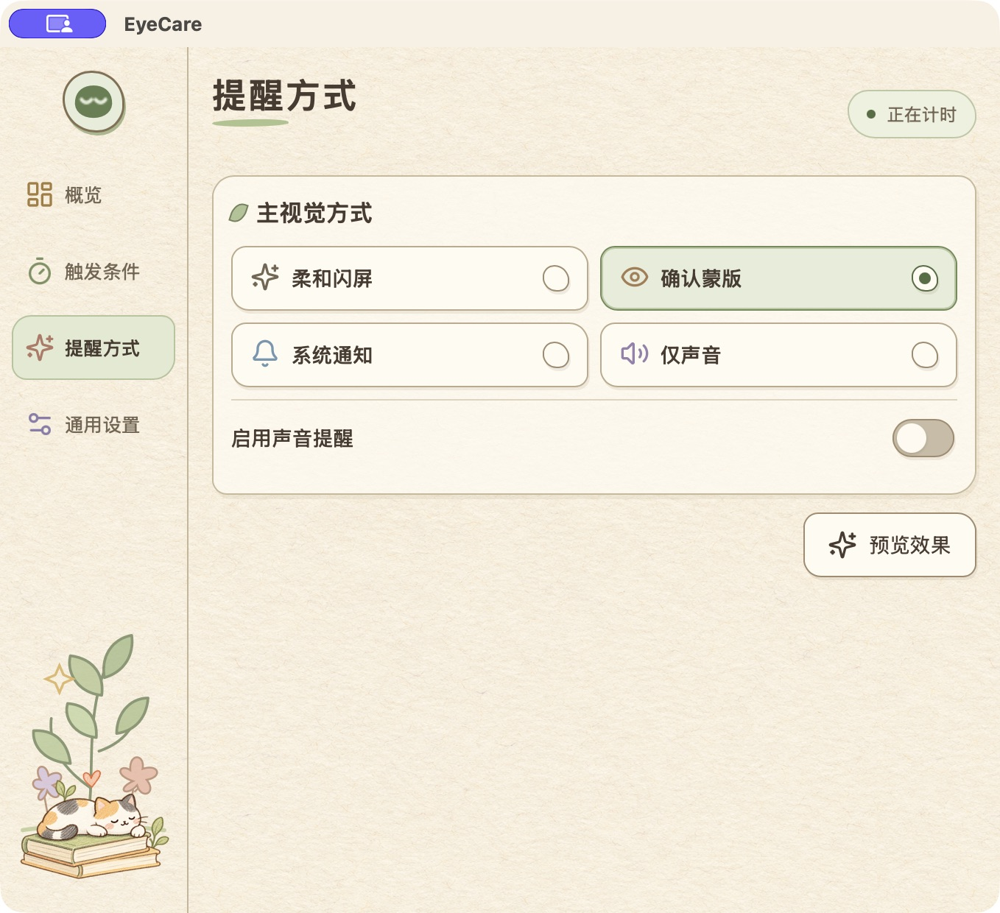
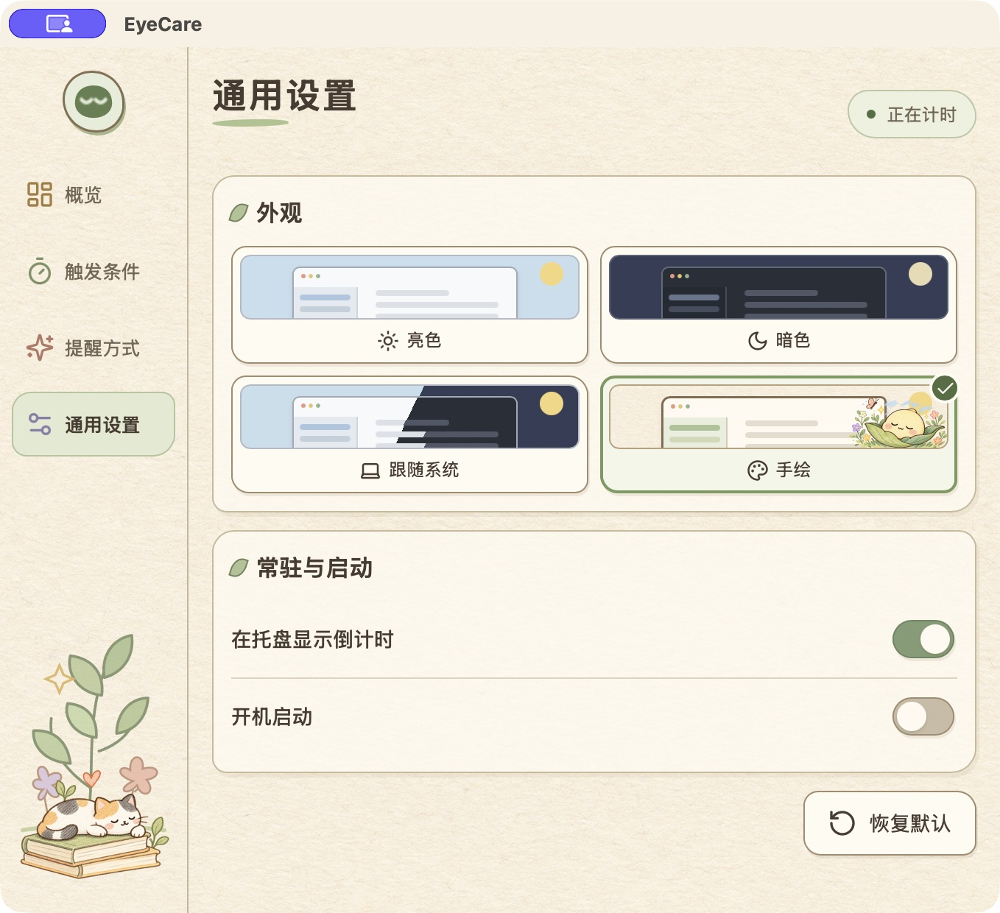
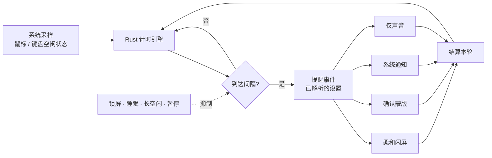

<div align="center">
  

  # EyeCare

  **让眼睛歇一会儿。**

  常驻系统托盘的护眼提醒工具，支持 macOS、Windows 与 Linux。它跟随真实的鼠标与键盘活动提醒你休息，所有配置都留在本机。

  <a href="LICENSE"></a>
  
  
  
  
  

  <a href="README.md">English</a> · <strong>简体中文</strong>
</div>

## 特点

- **统计的是活动，不是墙上的时间。** 离开电脑的时间不计入间隔，提醒会在你真正盯着屏幕一段时间之后才出现。
- **四种提醒方式。** 柔和闪屏、确认蒙版、系统通知、仅声音；视觉提醒可以叠加声音。
- **默认安静。** 锁屏、睡眠、长时间空闲或系统能力异常时会抑制新提醒，错过的提醒不会补发。
- **Rust 掌握时钟。** 计时、采样与提醒状态都在 Rust 内核里，前端只负责渲染快照和发送命令。
- **数据不出本机。** 不记录按键内容、不采集鼠标轨迹、不截屏、不联网。

## 功能

| 方面 | 内容 |
| --- | --- |
| 计时模式 | 累计活跃时间，或固定周期 |
| 提醒方式 | 柔和闪屏、确认蒙版、系统通知、仅声音 |
| 离开检测 | 60 秒活动窗口；长时间空闲会清零进度且不触发提醒 |
| 托盘 | 菜单栏倒计时、暂停 / 恢复、立即提醒、设置、退出 |
| 手动暂停 | 一直保持暂停，直到你主动恢复 |
| 设置 | 八项核心选项，自动保存，写入磁盘前先校验 |
| 外观 | 默认手绘风，也可选亮色 / 暗色 / 跟随系统；尊重减弱动态与减弱透明偏好 |

## 界面截图

| 概览 | 触发条件 |
| --- | --- |
|  |  |
| **提醒方式** | **通用设置** |
|  |  |

确认蒙版是唯一会等待你回应的方式——点击「知道了」记为一次确认的休息，并开始下一轮：


## 一轮提醒如何走完



中间那个矩形是你可配置的部分，其余都是固定约定：淡入淡出时长、文案、音效与覆盖屏幕范围都不可调，也没有稍后提醒。

### 计时与提醒规则

| 场景 | 行为 |
| --- | --- |
| 累计活跃时间 | 任何鼠标或键盘输入都会维持一个固定的 60 秒活动窗口，窗口之外不累计 |
| 固定周期 | 按配置的间隔提醒；被锁屏、睡眠、手动暂停抑制的周期直接跳过 |
| 达到空闲清零时间 | 进度清零且不触发提醒；手动暂停期间同样清零 |
| 柔和闪屏 | 全屏黑色遮罩约 2 秒内淡入、停留、淡出，峰值 90% 不透明度；不抢焦点且点击穿透 |
| 确认蒙版：知道了 | 关闭蒙版，记为一次确认的休息，清零进度并开始下一轮 |
| 关闭蒙版 / Escape | 跳过本轮，不记为确认的休息 |
| 通知已投递 / 声音播完 | 自动结束本轮，不记为确认的休息 |
| 预览效果 | 不影响真实计时进度与休息记录 |

提醒覆盖所有已接显示器；内置轻柔提示音每轮只播放一次，音量固定 50%。

## 设置一览

| 页面 | 设置项 | 默认值 | 范围 / 选项 |
| --- | --- | --- | --- |
| 触发条件 | 计时模式 | 累计活跃时间 | 累计活跃时间 / 固定周期 |
| 触发条件 | 活跃提醒时间 | 30 分钟 | 1–240 的整数分钟 |
| 触发条件 | 空闲清零时间 | 10 分钟 | 1–120 的整数分钟；仅累计活跃时间模式显示 |
| 提醒方式 | 主视觉方式 | 柔和闪屏 | 柔和闪屏 / 确认蒙版 / 系统通知 / 仅声音 |
| 提醒方式 | 启用声音提醒 | 关闭 | 开 / 关；选择「仅声音」时强制开启 |
| 通用设置 | 外观 | 手绘 | 手绘 / 跟随系统 / 亮色 / 暗色 |
| 通用设置 | 在托盘显示倒计时 | 开启 | 开 / 关 |
| 通用设置 | 开机启动 | 关闭 | 开 / 关 |

保存是自动的：数字输入在停止输入约 300 毫秒后、或失去焦点时提交。数值非法或写入失败会保留上一份有效配置并说明原因，恢复默认会先征求确认。

选项名称会随模式变化——同一项在累计活跃时间模式下叫「活跃提醒时间」，在固定周期模式下叫「间隔时间」。窗口较窄时侧栏收成图标，悬停即可看到页面名。

## 快速开始

### 环境要求

- **Node.js 24**（发布工作流锁定 24.15.0）与 **npm 11**
- **Rust 1.90+**，通过 [mise](https://mise.jdx.dev/) 安装，让 `npm` 脚本解析到同一套工具链（`mise install`）
- Tauri 各平台前置依赖：macOS 需要 Xcode 命令行工具；Windows 需要 MSVC C++ 生成工具与 WebView2；Linux 需要 WebKitGTK 4.1 与常用构建库
- Git 与可用的桌面会话

### 从源码运行

```bash
git clone https://github.com/ShenZiLi/EyeCare.git
cd EyeCare
npm ci
npm start
```

`npm start` 会同时拉起 Tauri 窗口与 Vite 开发服务。只跑 `npm run vite:dev` 只能访问前端页面，原生命令需要 Tauri 宿主。

## 构建与打包

```bash
npm run package   # 仅编译，不生成安装包
npm run make      # 编译并生成原生安装包
```

产物位于 `src-tauri/target/release/bundle/`：macOS 为 DMG 与 `.app`，Windows 为 MSI 与 NSIS，Linux 为 deb、rpm 与 AppImage。请在目标系统上构建；签名沿用 Tauri 的平台签名配置。

## 开发与验证

技术栈：**Tauri 2 · Rust · React 19 · TypeScript · Vite**。

```bash
npm run check             # TypeScript、lint、前端测试与 Rust 测试
npm run test:unit         # 前端设置与控制器测试
npm run test:integration  # Rust 运行时测试（cargo test）
npm run vite:build        # 前端生产构建
npm run tauri:build       # 原生生产构建与安装包
```

```text
EyeCare/
├── app/renderer/   # React 页面、覆盖层与 Tauri invoke/listen 桥
├── app/shared/     # TypeScript 契约与设置校验
├── src-tauri/      # Rust 运行时：计时引擎、平台适配、设置、托盘、提醒
├── tests/unit/     # 前端控制器与设置测试
├── resources/      # 图标源文件与生成资源
├── scripts/        # 资源生成脚本
└── docs/           # 迁移笔记、验收证据与 README 配图
```

计时与提醒状态由 Rust 运行时掌握，页面只渲染快照并发命令；关闭主窗口即隐藏窗口，托盘运行时继续工作。

## 平台支持

macOS、Windows、Linux 都是构建目标。macOS 有完整的原生适配（输入、连续时钟、锁屏状态）；Windows 与 Linux 目前报告能力受限，关键状态未知时会抑制提醒。

Windows 与 Linux 的完整对等——物理锁屏与睡眠、多屏覆盖、通知投递、开机启动——仍需实机验收。`docs/` 下的文件记录的是早期实现证据与 Tauri 迁移清单，已退役的 Electron 实现的历史结论不能证明当前行为。

## 隐私

- EyeCare 只读取系统活动与空闲状态，不记录按键内容、鼠标轨迹或屏幕图像，也不发起网络请求。
- 设置保存在 Tauri 应用数据目录 `org.eyecare.app` 下的 `settings.json`；首次运行会从旧 EyeCare 目录导入已有配置。
- 最后一份有效配置留存为 `settings.last-good.json`；升级旧配置前会先保留为 `settings.v1-backup.json`。
- 从旧版本升级会保留这八项核心选择，已退役的高级参数不再影响运行行为。
- 重启后恢复设置并重新开始一轮计时，关闭期间错过的提醒不会补发。

## 常见问题

**macOS 上系统通知始终不出现？**
先用打包后的应用测试，再检查「系统设置 → 通知 → EyeCare」。权限状态、专注模式与屏幕共享都可能拦截横幅。提交成功不等于横幅可见。

**倒计时不动了，或者提醒不再出现？**
累计活跃时间模式下，60 秒活动窗口过期后就会暂停累计。手动暂停、锁屏、睡眠、长时间空闲或关键能力未确认同样会抑制提醒。手动暂停后请从托盘或概览页恢复。

**开机启动没有生效？**
先看应用给出的错误提示，再检查系统的登录项设置。注册或写入失败时，应用会保留上一份有效配置并尝试还原此前的系统状态，你可以直接重试。

**构建成功，但完整的应用在哪里？**
`npm run make` 之后到 `src-tauri/target/release/bundle/` 找。`npm run package` 是有意只编译、不产出安装包的。

**能改淡入淡出时长、文案或音效吗？**
不能。这些是固定约定，好让提醒保持可预期；上面那八项就是全部可配置范围。

## 参与贡献

通过 [Issues](https://github.com/ShenZiLi/EyeCare/issues) 反馈问题或提出改进，通过 [Pull Requests](https://github.com/ShenZiLi/EyeCare/pulls) 提交代码。

一份有用的 issue 应包含：系统版本、CPU 架构、桌面环境或 X11/Wayland 会话、EyeCare 版本、复现步骤、期望行为，以及报错截图。不要附带凭据或含隐私信息的配置文件。

提交前请跑通相关检查，并为行为变更补充针对性测试。涉及系统能力的改动，请说明实机测试环境以及仍未验证的部分。

## 许可

[MIT](LICENSE) © 2026 EyeCare contributors
