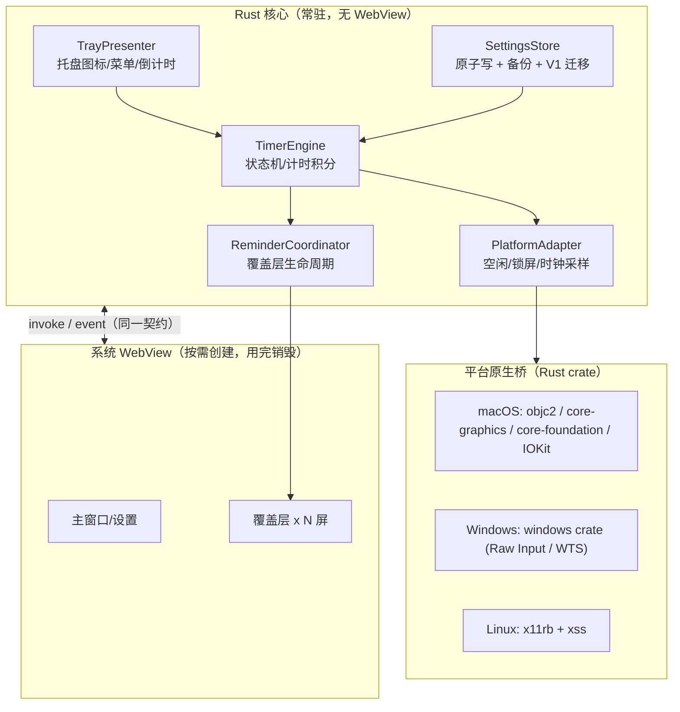

> 当前分支状态：已按分支范围清除 Electron 实现、依赖、Forge 构建与 Electron 测试，仅保留 Tauri。本文保留迁移对照及待验收项；原 Electron 源码路径和下方延后删除的策略仅为历史记录，当前以 `src-tauri/`、根目录脚本和 README 为准。清理不代表迁移清单中的未完成项已经通过验收。

# EyeCare → Tauri 迁移清单

> 目标：把 Electron 44 主进程替换为 Tauri 2（Rust 核心 + 系统 WebView），常驻内存 140MB → 40–80MB，安装包 ~180MB → ~10MB。
> 约束：保持现有三界面（主/设置、托盘、覆盖层）、`RuntimeSnapshot` 契约、定时引擎语义与设置文件兼容。
>
> 分支：`dev-tauri`（从 `main` 切出）；Rust 工具链由根目录 `mise.toml` 提供（cargo 1.99.1），
> 非交互 shell 中请用 `mise exec -- cargo ...`，npm 脚本 `tauri:dev` / `tauri:build` 已内建 `mise exec`。

---

## 进度

| Phase | 状态 | 说明 |
|---|---|---|
| 0 · 基线冻结 | 未做 | 尚未打 tag、未导出契约快照 |
| 1 · Tauri 骨架 | 完成 | `src-tauri/` 已生成并配置（identifier `org.eyecare.desktop`、`windows: []`、`macOSPrivateApi`）；`app/renderer/bridge.ts` 已就绪；`npm run vite:dev` / `vite:build` 已接入；`lib.rs` 用 `WebviewWindowBuilder` 创建主窗口（600×500、`?surface=main`、标签 `main`），并注册 `get_snapshot` / `settings_requested`，前端可直接拿到快照。其余 14 个命令留到 Phase 6 |
| 2 · 定时引擎移植 | 完成 | `src-tauri/src/engine.rs` + `src-tauri/src/engine/tests.rs`，`cargo test` 28 项全部通过 |
| 3 · 平台原生桥 | 完成（macOS） | `src-tauri/src/platform/`：`mod.rs` 移植 `PlatformAdapter`（连续时钟回退、能力报告、显示器、系统主题），`macos.rs` 移植 `createMacProvider`（`mach_continuous_time`、`CGEventSourceSecondsSinceLastEventType`、会话字典 + IOKit `IOConsoleLocked`）。Windows/Linux 按约定先整体降级为 `unsupported`。`reduceMotion` / `reduceTransparency` / `sleeping` 属「外观/系统事件」，留到 Phase 4 |
| 4 · 窗口/托盘/覆盖层/通知 | 进行中（窗口/托盘/覆盖层/通知已完成） | 已完成：主窗口关闭直接隐藏（无说明弹窗）、macOS Dock 图标隐藏/恢复与 1100ms 冷却、`window-all-closed` / `activate` 语义、托盘图标与模板图、macOS 倒计时标题、六项右键菜单与禁用态、`hasConfirmedTray` / `presentedSnapshot` 托盘降级、托盘刷新主线程投递、覆盖层窗口 + `ReminderCoordinator` 协调器、通知型提醒与点击回主窗口。待做：外观与电源事件 |
| 5 · 设置持久化与自启 | 完成（Windows 自启待 Phase 7） | `src-tauri/src/settings/`：`validation.rs`（V2 严格校验 + V1 迁移校验）、`store.rs`（原子写 + `fsync`、`link` 留档、V1→V2 迁移、`revision` 乐观并发）、`mod.rs`（旧 Electron 数据目录一次性补齐）、`save.rs`（登录启动事务编排）。`src-tauri/src/autostart.rs`：macOS 走 `SMAppService`、Linux 走 `.desktop`，含 `prepareLoginChange` 的 capture→apply→校验→rollback。`cargo test` 64 项全部通过。`lib.rs` 启动时从仓库读入设置与 `revision`，并把启动期告警并入每份快照。**自启的 Windows 分支（`StartupApproved` 快照、Squirrel 启动项升级）随 Windows 原生桥留到 Phase 7** |
| 6 · IPC 契约对齐 | 完成 | `src-tauri/src/ipc.rs` + `src-tauri/src/lib.rs`：15 个命令已注册（`get_snapshot` / `settings_requested` / `save_settings` / `pause` / `resume` / `remind_now` / `resolve_reminder` / `preview` / `cancel_preview` / `get_overlay` / `overlay_ready` / `overlay_sound_started` / `overlay_finished` / `open_settings` / `quit`），名称与载荷字段对齐 `bridge.ts`；`ipc.rs` 移植载荷校验与错误码；`command_gate`（`Mutex<()>`）对齐 `commandQueue`；`presented_snapshot` 合并 `previewSequence` / `currentPreviewId` / `latestPreviewResult` 与启动期告警；`save_settings` 接上 `save_with_login`、`validate_settings` 与 `SETTINGS_CONFLICT`。`src-tauri/src/reminders.rs` 的 `ReminderCoordinator` 已在 Phase 4 补齐为完整实现（会话状态机、覆盖层窗口、通知、结算回调）。`cargo test` 75 项全部通过 |
| 7–8 | 未开始 | — |

## 0. 迁移原则（先定边界）

| 类别 | 处理方式 | 说明 |
|---|---|---|
| 渲染层 `app/renderer/*`（React 19 + `styles.css`） | **原样复用** | 仅替换 `window.eyeCare` 的来源 |
| 契约 `app/shared/contracts.ts` | **原样复用 + Rust 侧镜像** | TS 类型继续给前端用；Rust 侧用 `serde` 结构体对齐 |
| 定时引擎 `app/main/engine/timer-engine.ts` | **重写为 Rust** | 该文件不依赖 Electron，是最适合移植的部分 |
| 平台桥 `app/main/platform/native.ts` | **重写为 Rust** | koffi FFI → 各平台 crate |
| 设置持久化 `settings-store.ts` / `validation.ts` | **重写为 Rust** | 保留原子写 + 备份 + V1 迁移语义 |
| 窗口/托盘/通知/覆盖层 | **改用 Tauri API** | `windows.ts` `coordinator.ts` `tray/presenter.ts` |
| 自启 `platform/autostart.ts` | **半重写** | 直接绑定平台 API（macOS `SMAppService` / Linux `.desktop`），capture→apply→校验→rollback 语义原样保留 |
| 校验脚本 `scripts/*.cjs` | **重写或保留为 Node 开发工具** | 见 Phase 7 |

> 判断依据：`timer-engine.ts` 与 `settings/validation.ts` 是纯逻辑（无 Electron import），是"照抄"；`index.ts` / `platform/index.ts` / `coordinator.ts` 深度耦合 Electron API，是"重写"。

---

## 1. 目标架构

关键收益点：**空闲态只有 Rust 核心在跑**，WebView 仅在弹设置或覆盖层时创建（`coordinator` 现有 teardown 逻辑正好匹配这个模型）。

---

## 2. 分阶段清单

### Phase 0 · 基线冻结

- [ ] 打 tag 冻结当前 Electron 版本，作为回滚点
- [ ] 记录基线指标：`~/Library/Application Support/EyeCare/settings.json` 内容、4 进程内存、冷启时间
- [ ] 导出当前 IPC 契约快照：`app/shared/contracts.ts` 中 `EyeCareBridge` 的 16 个方法 + 12 个 `eyecare:*` 通道
- [ ] 固化设置文件兼容基线：`settings.json`、`settings.last-good.json`、`settings.v1-backup.json` 三个文件路径与 schema

### Phase 1 · Tauri 骨架

- [ ] 初始化 `src-tauri/`（`Cargo.toml`、`tauri.conf.json`、`build.rs`、`capabilities/`）
- [ ] 保留 Vite 作为前端构建（`vite.renderer.config.ts` 基本沿用），把输出目录指向 Tauri 的 `frontendDist`
- [ ] 配置多窗口入口 URL 带 query，沿用 `?surface=main|tray|overlay` 约定（对齐 `app/renderer/main.tsx#L6-L8`）
- [ ] 接入 `tauri-plugin-single-instance`（对齐 `app/main/index.ts#L212` 的 `requestSingleInstanceLock`）
- [ ] 建立 `bridge.ts`：用 `@tauri-apps/api`（`invoke` + `listen`）实现与 `EyeCareBridge` **同形状**的对象
- [ ] 让 `app/renderer/*.tsx` 不修改即可运行（`App.tsx` / `Overlay.tsx` / `Settings.tsx` 原样）

### Phase 2 · 定时引擎移植（纯逻辑）

- [ ] 在 Rust 实现 `TimerEngine`，逐条对齐 `app/main/engine/timer-engine.ts`：
  - [ ] `acceptSample` 的时钟回退拒绝、`delta > 5000` 告警、积分窗口 union 算法（`L137-L149`）
  - [ ] `active` / `fixed` 两种模式与错过的节拍处理（`L150-L155`）
  - [ ] `suppressed()` / `status()` / `fault()` 的状态优先级（`L37-L59`）
  - [ ] `present` / `cancel` / `settleReminder` / `recordReminderChannels` 的 generation 校验
  - [ ] `longIdle` 与 `absenceSince` 的清零规则（`L128-L132`）
- [ ] 把 `tests/unit/timer-engine.test.ts` 的用例移植为 `cargo test`（同一组输入向量，作为移植正确性判据）
- [ ] 保留 TS 版引擎作为 reference，仅用于对照，不进产物

### Phase 3 · 平台原生桥（koffi → Rust）

按平台逐项替换 `app/main/platform/native.ts`：

- [ ] **macOS 空闲/时钟**
  - [ ] `CGEventSourceSecondsSinceLastEventType(0, 0xffffffff)` → `objc2-core-graphics`
  - [ ] `mach_continuous_time` + `mach_timebase_info` → `objc2-core-foundation` / `libc`
  - [ ] 鼠标源事件掩码列表 `[1,2,3,4,5,6,7,22,25,26,27]` 保持一致
- [ ] **macOS 锁屏**
  - [ ] `CGSessionCopyCurrentDictionary` → `objc2-core-foundation`；键 `CGSSessionScreenIsLocked`、`kCGSSessionOnConsoleKey`、`CGSSessionUserIDKey`
  - [ ] `IOKit` 的 `IOConsoleLocked` 根节点属性
  - [ ] 严格保留"缺失不等于 false"的判定（`native.ts#L172-L180`）
- [ ] **Windows**
  - [ ] `GetLastInputInfo` / `ProcessIdToSessionId` → `windows` crate
  - [ ] `WTSQuerySessionInformationW(WTSConnectState)` + `OpenInputDesktop` → `windows` crate
  - [ ] Raw Input 鼠标桥（`RegisterRawInputDevices` + 隐藏窗口）→ `windows` crate
- [ ] **Linux**
  - [ ] `CLOCK_BOOTTIME` → `libc`
  - [ ] `XScreenSaverQueryInfo` → `x11rb` + `xss`
- [ ] 保留 `NativeProvider` 的 `unknown`/`error` 语义，`PlatformAdapter` 的 capability 上报文案逐条对齐（`platform/index.ts#L24-L30`）

### Phase 4 · 窗口 / 托盘 / 覆盖层 / 通知

- [x] **主窗口**：对齐 `app/main/index.ts#L93-L125`
  - [x] 关闭窗口 = 直接隐藏，不再弹出后台运行说明，仅托盘可用时允许隐藏
    > `src-tauri/src/lib.rs`：`create_main_window` 注册 `WindowEvent::CloseRequested`，托盘经 `has_confirmed_tray` 确认后 `prevent_close` + 隐藏；无托盘时放行关闭。`main_visibility_generation` 防止过期隐藏请求覆盖后续打开操作。`RunEvent::ExitRequested { code: None }` 承接 `window-all-closed`
  - [x] macOS 关闭后隐藏 Dock 图标、重开时恢复（`hideMainDock` / `app.dock` 逻辑 → Rust 侧 `NSApplication` / `set_activation_policy`）
    > 用 `AppHandle::set_dock_visibility` 替代 `app.dock.hide()/show()`（非 macOS 走空实现，保证同一份窗口逻辑跨平台可编译）；沿用 TS 的 1100ms 冷却，用「起线程 sleep + `run_on_main_thread` 回来重新校验」代替 `setTimeout` + `cancelDockHide`。整个判定固定在主线程执行，避免从对话框回调线程读到过期的 `is_visible`
- [x] **托盘**（`tray/presenter.ts` → `src-tauri/src/tray.rs` + `src-tauri/src/tray/icon.rs`）
  - [x] 图标 + `iconAsTemplate`（macOS 模板图）
    > 图标改为 `include_bytes!` 编译期嵌入 `resources/tray-rest-{light,dark}.png`，避免 dev 与打包环境的资源路径差异。macOS 直接交给 tray-icon（它会把图标统一缩到 18pt 高）；其余平台用 `image` crate 缩到 32px，对齐 Electron 的 `resize({ width: 32 })`
  - [x] macOS 倒计时 `setTitle(formatTime)` + 等宽数字字体
    > `set_title` 已对齐；**等宽数字字体未设置**（Tauri `set_title` 没有 TS 的 `fontType: 'monospacedDigit'` 选项），倒计时跳动时标题宽度可能轻微抖动
  - [x] 右键菜单六项（打开概览 / 暂停·恢复 / 立即提醒 / 设置 / 退出）+ 禁用态
    > 状态标题项 `enabled(false)`；「立即提醒」仅 `counting` / `short_idle` 可用；暂停与恢复按状态二选一生成菜单项。菜单动作经 `crate::handle_tray_menu` 分发，暂停/恢复复用 IPC 同一份 `pause_action` / `resume_action`，`MENU_REMIND_NOW` 被抑制时只推快照不报错（对齐 TS 的 `try/catch`）
  - [x] 非 macOS 点击弹菜单
    > `TrayIconBuilder::show_menu_on_left_click(true)`，与 TS 的非 macOS `popUpContextMenu()` 行为一致
  - [x] `presentedSnapshot` 的托盘降级覆盖 + `hasConfirmedTray` + `tick` 的能力报告降级，三处语义与 TS 同名逻辑一致
  - [x] 托盘刷新统一投递到主线程
    > tauri 的托盘 setter 经 `run_item_main_thread!` **阻塞**等待主线程执行；若在采样线程直接调用，会与主线程上的托盘菜单回调互相等待。因此 `emit_snapshot` 用 `run_on_main_thread` 投递，采样线程全程不阻塞
- [x] **覆盖层**（`coordinator.ts#L88-L122` → `src-tauri/src/reminders.rs`）
  - [x] 每显示器一个 `WebviewWindow`：无边框、透明、`skipTaskbar`、不可移动/缩放
    > 标签为 `overlay-<n>`（`n` 由进程内原子计数分配），加载 `index.html?surface=overlay`；声音宿主窗口标签为 `*#sound`、尺寸 1×1 且 `visible(false)`
  - [x] 置顶层：`setAlwaysOnTop(true, 'screen-saver')` → Tauri `set_always_on_top`
    > Tauri 的 `always_on_top(bool)` 不暴露窗口 level，覆盖层落在 `floating` 层而非 TS 的 `screen-saver` 层：**叠在普通全屏应用之上仍成立，但其他应用的全屏独占空间可能盖住覆盖层**。跨全屏空间沿用 Electron 的 `set_visible_on_all_workspaces(true)`（Tauri 已暴露）
  - [x] `flash` 用 `show_inactive`，`mask` 可聚焦；非 mask 走 `set_ignore_cursor_events(true)`
    > Tauri/tao **没有 `showInactive`**：`set_visible(true)` 走 `make_key_and_order_front_sync`。已用 `focusable(false)` 降低抢焦点概率，但仍可能让应用变成前台应用（偏差）
    > `set_ignore_cursor_events(true)` 无 TS 的 `forward` 选项，非 mask 覆盖层完全不接收鼠标事件，与 TS 语义一致
  - [x] `loadSurface` 的 URL 来源校验（`windows.ts` 的 `surfaceURLs` + `trustedSource`）→ Tauri capability/ACL 等价实现
    > `capabilities/default.json` 的 `windows` 扩到 `["main", "overlay-*"]`，命令层用 `WebviewWindow` 参数拿到真实标签做归属校验（`overlay_state(label)` 反查会话），因此不再需要 `surfaceURLs` + `trustedSource` 的 URL 白名单
  - [x] 保留 12s 就绪超时、热插拔 `refreshDisplays`；`render-process-gone`/`unresponsive` 等价事件
    > 12s 就绪超时与热插拔逐屏重建（保留旧窗口复用、销毁被移除显示器上的窗口）已对齐
    > **Tauri 未暴露渲染进程崩溃与无响应事件**，只能用 `WindowEvent::Destroyed` 兜底：非收尾路径下的销毁记「提醒窗口意外关闭」并让会话失败（偏差）
  - [x] 会话状态机与锁序纪律
    > 会话状态用内部 `Mutex<Option<Session>>`，窗口创建/销毁、定时器回调、结算回调一律在**释放锁之后**执行：覆盖层 `Destroyed` 回调与持锁方在同一线程时会互相等待，必须先把窗口从会话登记中摘除再 `destroy()`
- [x] **通知**：`tauri-plugin-notification`
  - [x] 提交超时 8s 判失败与 macOS 未授权文案（`coordinator.ts#L5-L10`）
    > **两处都无法照搬**：桌面版 `permission_state()` 恒为 `Granted`（无未授权文案场景）；macOS 上 `show()` 在后台任务里派发，OS 层失败被 `let _ = notification.show()` 吞掉，`Ok` 即视为「已提交」，因此 8 秒未确认保护被替换为「提交即记录成功」
  - [x] 通知点击 → 打开概览
    > `Notification::on_action` 捕获 `action_id() == "tap"`，回调在后台线程执行，经 `run_on_main_thread` 投递后复用 `show_main`
    > **通知无法撤回**：TS 在视觉通道失败时会 `close()` 掉通知，Tauri 在 macOS/Windows 上不能移除已显示的通知（偏差）
- [ ] **外观/系统事件**（Phase 4 步骤 3）
  - [ ] `nativeTheme.shouldUseDarkColors` / `prefersReducedTransparency` → Tauri window theme / `NSAppearance`
  - [ ] `systemPreferences.getAnimationSettings().prefersReducedMotion` → 原生查询
  - [ ] `powerMonitor` 的 suspend/resume/lock-screen/unlock-screen/user-did-resign/become-active → macOS `NSWorkspace` 通知（sleep/wake、`com.apple.screenIsLocked` 分布式通知）
  - [ ] `screen` 的 display-added/removed/metrics-changed → Tauri monitor 事件

### Phase 5 · 设置持久化与自启

- [x] **SettingsStore 移植**（`settings-store.ts` → `settings/store.rs`）
  - [x] 同款原子写：临时文件 + `fsync` + `rename`，文件权限 `0o600`
  - [x] 三份文件路径与命名保持一致（`settings.json` / `settings.last-good.json` / `settings.v1-backup.json`）
  - [x] 备份发布用 `link` 保证"永不覆盖第一份"（`L45-L60`）
  - [x] V1→V2 迁移与 `revision` 乐观并发（`SETTINGS_CONFLICT`）
- [x] **`data dir` 兼容迁移（必做）**
  - [x] 现状：Electron `app.getPath('userData')` = `~/Library/Application Support/EyeCare`
  - [x] Tauri `app_data_dir()` 默认基于 bundle identifier，路径不同
  - [x] 首启做一次性迁移：老目录存在且新目录缺失时搬运三份设置文件，失败时保留原文件并给出 warning
- [x] **自启**（`autostart.ts` → `src-tauri/src/autostart.rs`）
  - [x] 基础开关直接绑定平台 API：macOS 用 `SMAppService`（与 Electron 同一注册项，避免遗留无法关闭的重复启动项）、Linux 写 `~/.config/autostart/eyecare.desktop`。**未引入 `tauri-plugin-autostart`**：它只覆盖基础开关，表达不了下一条的三段语义
  - [x] `setLaunchAtLogin` 写后回读校验：非 Linux 平台回读不到目标状态即报「系统未保存登录启动设置」
  - [x] 迁移 `prepareLoginChange` 的 **capture → apply → 校验 → rollback** 语义（macOS 以系统注册项状态为准；Linux 按字节 + 权限位恢复，且读写前后都拒绝符号链接）
  - [x] 迁移 `autostartExecutable` 的 AppImage/`APPDIR` 路径保护（登记原始镜像路径，绝不写 `/tmp/.mount_*`）
  - [x] 迁移 `autostartDesktopEntry` 的 Exec 转义（反斜杠四倍、「`"`/`` ` ``/`$`」再加一层）
  - [ ] Windows 注册表快照（`StartupApproved` 二进制值）capture/restore
  - [ ] 迁移 Windows 旧 Squirrel 启动项升级 `migrateWindowsLaunchAtLogin`
    > 以上两项依赖 `app.getLoginItemSettings().launchItems` 这类 Electron 专有 API，需要与 Windows 原生桥（Phase 3/4 已整体降级）一起实现，留到 Phase 7。当前 Windows 分支返回明确的未实现错误，绝不静默跳过
- [x] `save-with-login.ts` 的「设置先落盘、自启后应用、失败回滚」编排保持一致（`settings/save.rs`）
  - [x] 读不到系统真实状态 → `LOGIN_READ_FAILED`，不动磁盘
  - [x] 系统拒绝写入 → 回滚后报 `LOGIN_WRITE_FAILED`
  - [x] 落盘失败 → 回滚系统状态；回滚失败报 `LOGIN_ROLLBACK_FAILED`，绝不谎称已恢复

### Phase 6 · IPC 契约对齐

- [x] 在 Rust 侧实现 15 个命令，名称与载荷字段与 `EyeCareBridge` 一一对应
  > `Bridge` 的 16 个方法里 `subscribeSnapshot` / `subscribeOverlay` / `subscribeOpenSettings` 是事件订阅，不是命令；其余 15 个命令已全部注册
  > `subscribeOverlay` 依赖的 `eyecare:overlay-updated` 事件随覆盖层窗口在 Phase 4 发出
- [x] 事件通道对齐：`eyecare:snapshot-updated`、`eyecare:open-settings`（`eyecare:overlay-updated` 随 Phase 4 覆盖层窗口）
- [x] 移植 `ipc-validation.ts`：载荷校验、`Result<T>` 错误码（`INVALID_COMMAND`/`REMINDER_BUSY`/`STALE_REMINDER`/`SETTINGS_CONFLICT`…）
  > Tauri 以具名参数绑定载荷，命令签名里的 `Option<Value>` 表达字段必填与类型校验；TS 的 `emptyPayload`/`payload` 白名单语义由参数集合加 `ipc::channel_results` 的逐字段白名单共同表达
  > 窗口身份校验（`isTrustedSurface`）依赖覆盖层窗口标签，随 Phase 4 接入
- [x] 保留命令串行化（`AppState.command_gate`，`Mutex<()>`）
- [x] 错误码与文案逐条对齐 `contracts.ts#AppError` 与现有 `CommandError`

### Phase 7 · 打包 / 签名 / 验收脚本

- [ ] `tauri.conf.json` bundle：`identifier = org.eyecare.desktop`、`category = public.app-category.healthcare-fitness`、图标 `resources/icon`
- [ ] macOS 签名/公证沿用现有环境变量：`EYECARE_SIGN_IDENTITY` / `EYECARE_APPLE_ID` / `EYECARE_APPLE_PASSWORD` / `EYECARE_APPLE_TEAM`
- [ ] 产物：`.app`/`.dmg`(macOS)、NSIS(Windows)、`.deb`/`.rpm`/AppImage(Linux)
- [ ] `scripts/probe-platform.cjs`、`verify-macos-runtime.cjs`、`verify-windows-runtime.cjs` → 改为 Rust 侧自检命令或 Node CLI 抽取
- [ ] `tests/integration/*` 与 `tests/e2e/*` 映射到 `cargo test` + tauri-driver（WebDriver）
- [ ] 保留 lint/typecheck 门禁：`npm run typecheck && npm run lint`（前端）+ `cargo clippy`（Rust）

### Phase 8 · 验收

- [ ] 内存达标：空闲态总 RSS ≤ 80MB（目标 40–60MB），且无 WebView 常驻进程
- [ ] 功能对齐：暂停/恢复、立即提醒、预览、三显示器覆盖、锁屏抑制、长空闲清零、通知通道
- [ ] 设置兼容：直接把旧 `settings.json` 放进新目录后启动，revision 与字段一致
- [ ] 自启：三平台开关 + 回滚路径各验证一次
- [ ] 崩溃恢复：覆盖层窗口被杀后按现有"安全关闭"语义收尾

---

## 3. 文件级映射表

| 现有文件 | 目标 | 动作 |
|---|---|---|
| [app/renderer/App.tsx](file:///Users/shen/Studio/Code/EyeCare/app/renderer/App.tsx) / Overlay.tsx / Settings.tsx / components.tsx / styles.css | 就地保留 | 复用（零改动） |
| [app/renderer/main.tsx](file:///Users/shen/Studio/Code/EyeCare/app/renderer/main.tsx) | 就地保留 | 仅新增 `import './bridge'`，保留 `?surface=` 分发 |
| [app/shared/contracts.ts](file:///Users/shen/Studio/Code/EyeCare/app/shared/contracts.ts) | `src/shared/contracts.ts` + `src-tauri/src/contracts.rs` | 复用 + Rust 镜像 |
| [app/main/engine/timer-engine.ts](file:///Users/shen/Studio/Code/EyeCare/app/main/engine/timer-engine.ts) | `src-tauri/src/engine.rs` | 重写（Rust） |
| [app/main/platform/native.ts](file:///Users/shen/Studio/Code/EyeCare/app/main/platform/native.ts) | `src-tauri/src/platform/{macos,windows,linux}.rs` | 重写（crate 替换 koffi） |
| [app/main/platform/index.ts](file:///Users/shen/Studio/Code/EyeCare/app/main/platform/index.ts) | `src-tauri/src/platform/mod.rs` | 重写 |
| [app/main/reminders/coordinator.ts](file:///Users/shen/Studio/Code/EyeCare/app/main/reminders/coordinator.ts) | `src-tauri/src/reminders.rs` | 重写（Tauri window） |
| [app/main/tray/presenter.ts](file:///Users/shen/Studio/Code/EyeCare/app/main/tray/presenter.ts) + icon.ts | `src-tauri/src/tray.rs` | 重写（Tauri tray） |
| [app/main/settings/settings-store.ts](file:///Users/shen/Studio/Code/EyeCare/app/main/settings/settings-store.ts) | `src-tauri/src/settings/store.rs` | 重写 |
| [app/main/settings/validation.ts](file:///Users/shen/Studio/Code/EyeCare/app/main/settings/validation.ts) / legacy-validation.ts | `src-tauri/src/settings/validation.rs` | 重写（纯逻辑） |
| [app/main/settings/save-with-login.ts](file:///Users/shen/Studio/Code/EyeCare/app/main/settings/save-with-login.ts) | `src-tauri/src/settings/save.rs` | 重写 |
| [app/main/platform/autostart.ts](file:///Users/shen/Studio/Code/EyeCare/app/main/platform/autostart.ts) | `src-tauri/src/autostart.rs` | 半重写 |
| [app/main/windows.ts](file:///Users/shen/Studio/Code/EyeCare/app/main/windows.ts) | `src-tauri/src/windows.rs` | 重写 |
| [app/main/ipc-validation.ts](file:///Users/shen/Studio/Code/EyeCare/app/main/ipc-validation.ts) | `src-tauri/src/ipc.rs` | 重写 |
| [app/main/index.ts](file:///Users/shen/Studio/Code/EyeCare/app/main/index.ts) | `src-tauri/src/lib.rs` + `main.rs` | 重写（应用编排） |
| [app/preload/index.ts](file:///Users/shen/Studio/Code/EyeCare/app/preload/index.ts) | `app/renderer/bridge.ts` | 替换（Tauri invoke/listen） |
| [forge.config.ts](file:///Users/shen/Studio/Code/EyeCare/forge.config.ts) | `src-tauri/tauri.conf.json` | 替换 |
| [vite.renderer.config.ts](file:///Users/shen/Studio/Code/EyeCare/vite.renderer.config.ts) | 同文件 | 沿用（调 `build.outDir`） |
| [vite.main.config.ts](file:///Users/shen/Studio/Code/EyeCare/vite.main.config.ts) / vite.preload.config.ts | — | 删除 |
| [tests/unit/timer-engine.test.ts](file:///Users/shen/Studio/Code/EyeCare/tests/unit/timer-engine.test.ts) | `src-tauri/src/engine.rs#[cfg(test)]` | 移植 |
| [tests/integration/*](file:///Users/shen/Studio/Code/EyeCare/tests/integration) / e2e/* | `src-tauri/tests/` + tauri-driver | 移植 |

---

## 4. 关键风险与验收点

| 编号 | 风险 | 验收方式 |
|---|---|---|
| R1 | 覆盖层要压过全屏应用并跨所有 Space。Tauri `set_always_on_top` 不足，需 objc 设 `NSWindowCollectionBehavior.canJoinAllSpaces \| .fullScreenAuxiliary` 与合适的 window level | 在全屏 Safari/视频下触发提醒，多 Space 各验一次 |
| R2 | macOS 锁屏判定：必须保留"键缺失 ≠ false"的保守语义，否则锁屏期间会误发提醒 | 反复锁/解锁各 10 次，确认状态切换与抑制 |
| R3 | 通知权限与签名强相关，未签名包在 macOS 可能拿不到授权 | 用正式签名包验证通知送达与点击 |
| R4 | WebView 常驻会吃掉全部收益——必须保证空闲态创建了 0 个 WebView | 空闲 10 分钟后 `ps`/`top` 确认无 webview 子进程 |
| R5 | 设置目录变更导致老用户配置丢失 | 首启迁移 + 断网/只读目录下的失败保留验证 |
| R6 | Windows 自启需读写 `StartupApproved` 二进制值，通用插件不覆盖 | Phase 7 单独回归 `prepareLoginChange` 的三段语义（当前 Windows 分支明确报未实现） |

---

## 5. 回滚策略

- 保留 Electron 分支与 tag，Phase 1–6 期间不删 `forge.config.ts` 与 `app/preload`
- Rust 侧与 TS 侧共用同一份 `contracts.ts`，契约变更必须双改
- 迁移完成且 Phase 8 全部通过后，再删除 Electron 相关文件与依赖
